# 永杰面板 · 原子化服务器管理看板

把服务器上的每个容器、systemd 服务、端口服务变成一张**独立卡片**，采用类 App 图标网格布局。
点击卡片直接进入 **dsh（DeepSeek Harness）原生工作区**；模型、文件、终端、会话全部由 dsh 提供，
面板只负责服务器总览、卡片管理、采集与跳转。

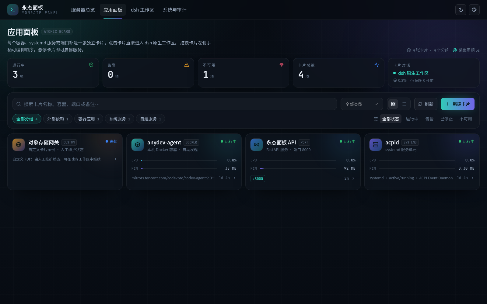

## 核心特性

| 能力 | 说明 |
| --- | --- |
| 服务器总览 | 首页实时呈现 CPU（含每核）、内存、磁盘分区与 IO、网络吞吐、TOP 进程与系统信息 |
| 原子化卡片 | 容器 / systemd / 端口 / 自定义四类卡片，注册表驱动，新增类型不改核心代码 |
| dsh 原生工作区 | 点击卡片进入 `/cards/:id/workspace`，按卡片自动选中对应工作区；顶部「dsh 工作区」页签可直接打开完整 dsh |
| 模型由 dsh 管理 | 面板不再保存模型 Key、不调用大模型；模型、工具、会话均在 dsh 内配置 |
| 无 Agent 配置 | 每张卡片只保留监控目标、分组、外观与采集开关，不再维护独立 agent |
| 优雅降级 | 单个服务读取失败只降级为「不可用」卡片并给出原因，接口永不 500 |
| 明暗双模式 | 白天 / 夜间一键切换，玻璃拟态卡片、极光渐变、状态呼吸灯在两种模式下都保持可读性 |
| 多套主题色 | 6 套强调色 × 明暗双模式，联动按钮渐变、环境光晕、图表曲线与 Element Plus 主色，本机记忆 |
| 大字号可读性 | 全站字号按 1.2 倍放大（正文 15.6px、卡片标题 16.8px），适合值班远距离阅读与投屏 |

<table>
  <tr>
    <td colspan="2">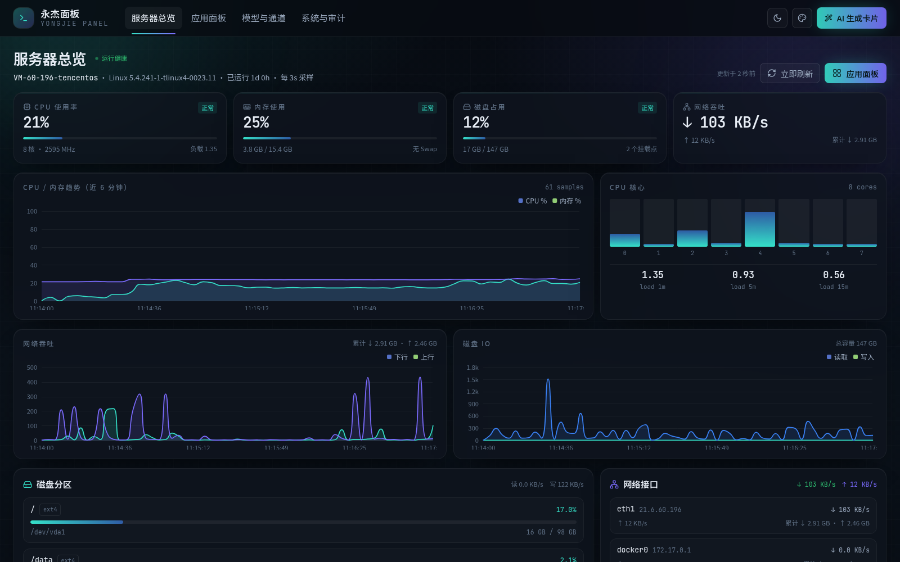</td>
  </tr>
  <tr>
    <td>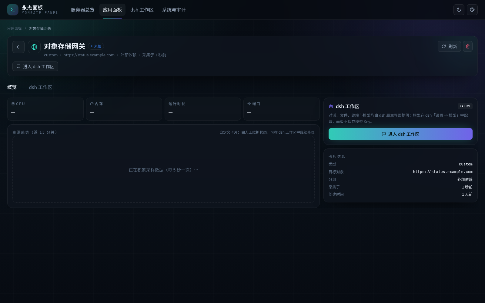</td>
    <td>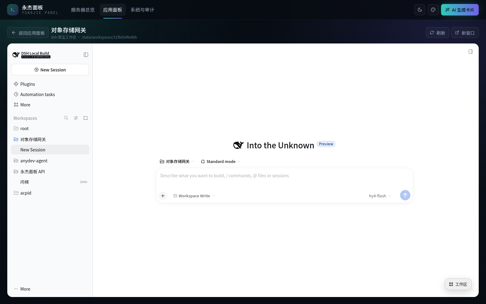</td>
  </tr>
  <tr>
    <td>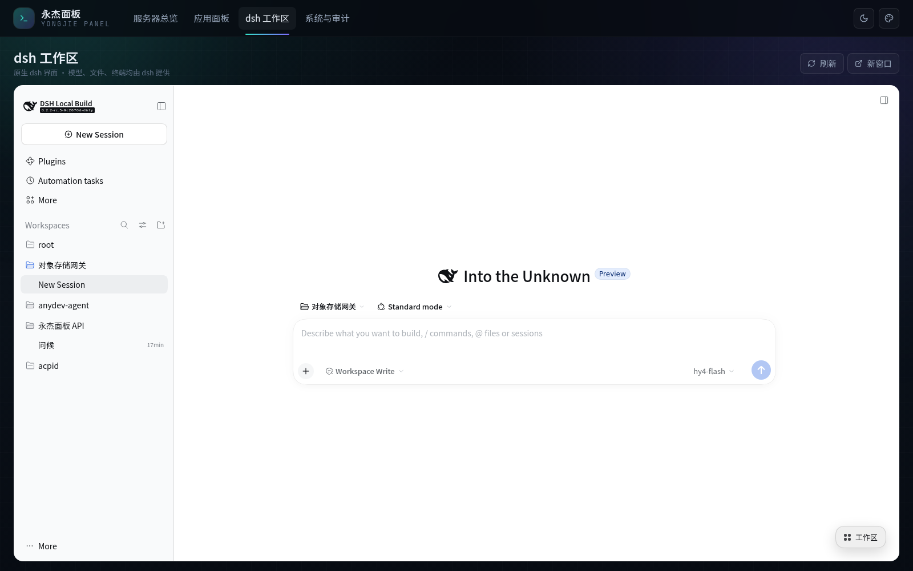</td>
    <td>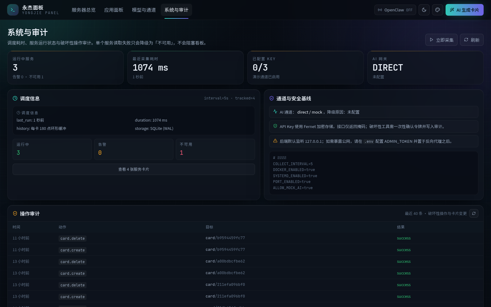</td>
  </tr>
  <tr>
    <td>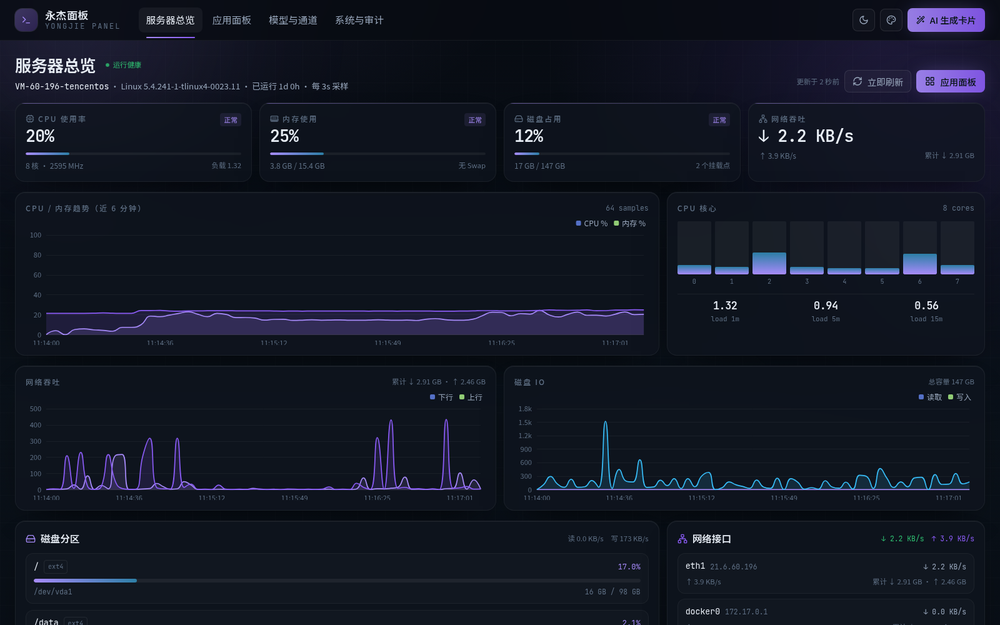</td>
    <td>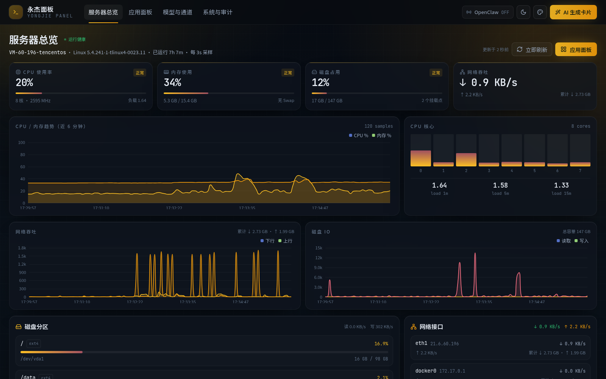</td>
  </tr>
  <tr>
    <td>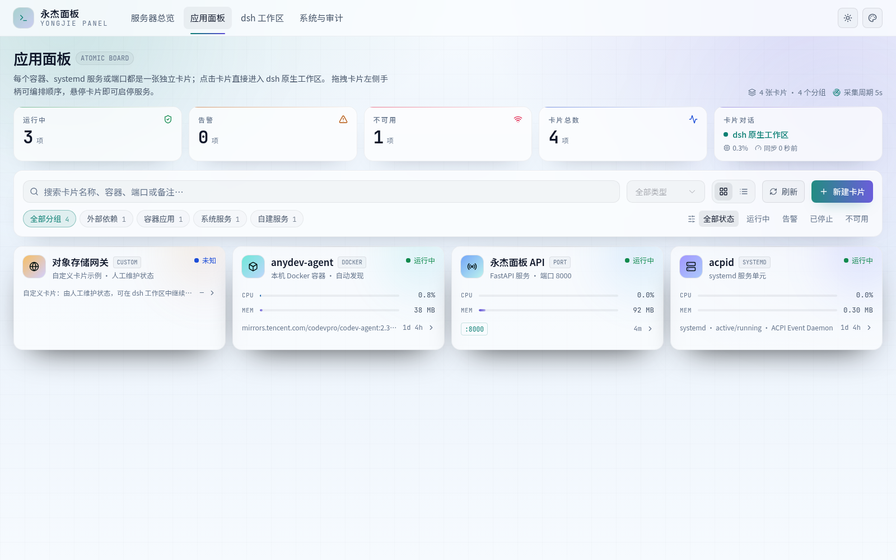</td>
    <td>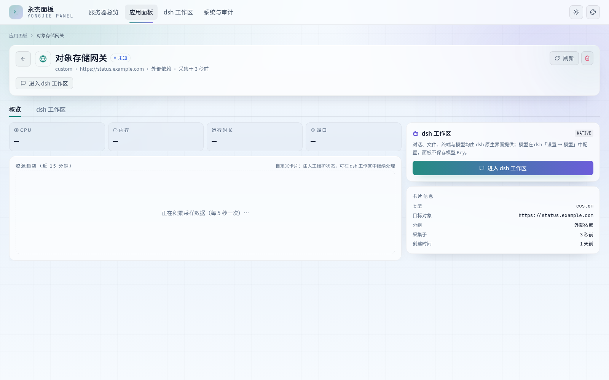</td>
  </tr>
  <tr>
    <td colspan="2">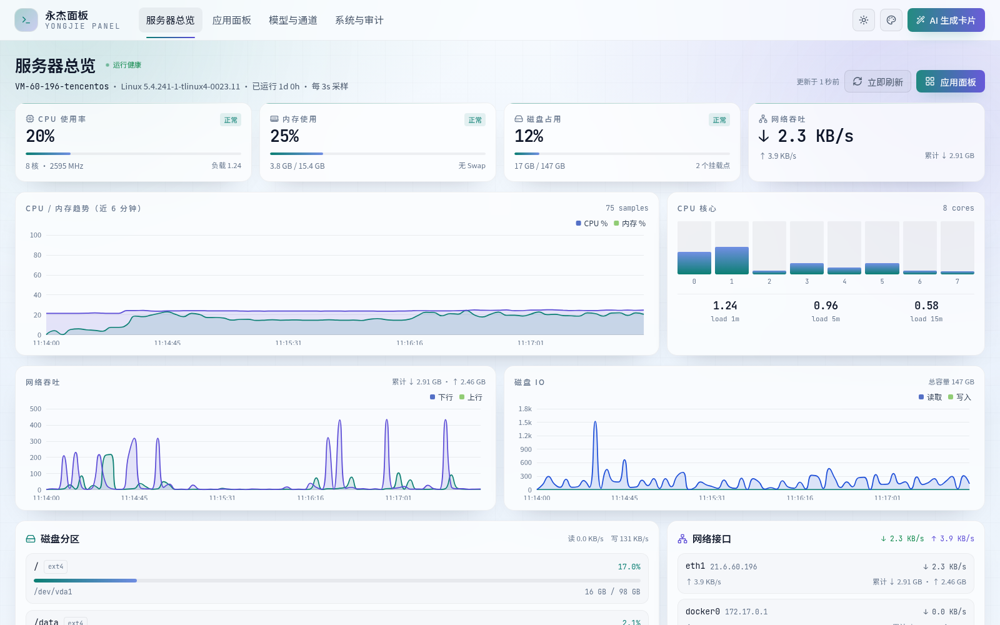</td>
  </tr>
</table>

## 技术栈

- **前端**：Vue 3.5 + TypeScript + Vite 5 + Element Plus + Pinia + Vue Router + ECharts + SortableJS + TailwindCSS
- **后端**：Python 3.11+ + FastAPI + Pydantic v2 + SQLAlchemy 2.0 + Alembic
- **存储**：SQLite（WAL），改 `DATABASE_URL` 即可切 PostgreSQL
- **采集**：docker SDK、`systemctl show`（argv 调用）、psutil

## 快速开始

前置：Python ≥ 3.11、Node ≥ 20、可访问的 Docker socket（可选）。

```bash
cp .env.example .env          # 按需填写 ADMIN_TOKEN / dsh 地址与 token
make install                  # 创建 .venv 并安装前后端依赖
make dev                      # 并行启动 API(8000) 与前端(5173)
```

页面路由：

| 路径 | 页面 |
| --- | --- |
| `/` | 服务器总览（CPU / 内存 / 磁盘 / 网络 / 进程） |
| `/board` | 应用面板（卡片网格） |
| `/cards/:id` | 卡片概览（日志、指标） |
| `/cards/:id/workspace` | dsh 原生工作区（内嵌 iframe，按卡片自动选中工作区） |
| `/dsh` | dsh 完整界面（顶部第 3 个页签） |
| `/system` | 系统与审计 |

打开 <http://127.0.0.1:5173> 即是**服务器总览**首页（`/`），应用卡片看板在 `/board`。
首次启动会自动从本机 Docker 与 systemd 发现服务并写入种子卡片；
若两者都不可用，也会创建端口卡片与自定义卡片，保证看板可用。

dsh 需单独启动（本仓库的开发环境默认使用 fork 版）：

```bash
cd /path/to/dsh-src
node apps/cli/lib/bin.js web --no-open --host 127.0.0.1 --port 3082
# 把日志中的 token 填入 .env 的 DSH_TOKEN，再重启后端
```

卡片与 dsh 工作区通过 `~/.dsh/storages/yongjie-cards.json` 映射；已有卡片可运行：

```bash
.venv/bin/python scripts/migrate_cards_to_workspaces.py
```


也可以分别启动：

```bash
make api    # http://127.0.0.1:8000/docs  (Swagger)
make web    # http://127.0.0.1:5173
```

### Docker Compose

```bash
cp .env.example .env
docker compose up -d --build
# 前端 http://127.0.0.1:5173 ，API http://127.0.0.1:8000
```

> 容器内没有 systemd，Compose 中已将 `SYSTEMD_ENABLED=false`。若要监控宿主 systemd unit，
> 请用宿主机方式运行后端（`make api`）。Compose 不包含 dsh，请按 `deploy/dsh/` 在宿主机安装，
> 并通过 `DSH_PUBLIC_URL` 指向 dsh 子域名。

## 部署

生产部署请阅读 **[部署指南 docs/deployment.md](docs/deployment.md)**，包含宿主机 systemd + nginx、Docker Compose、
HTTPS、配置项、备份恢复、升级与排障；dsh 的安装、补丁与启动见 **[deploy/dsh/README.md](deploy/dsh/README.md)**。`deploy/` 目录提供可直接使用的示例：

| 文件 | 用途 |
| --- | --- |
| [`deploy/install.sh`](deploy/install.sh) | 项目目录内一键安装（venv + 后端依赖 + 前端构建 + 复制 `.env` + 初始化数据库） |
| [`deploy/dsh/install.sh`](deploy/dsh/install.sh) | 安装固定版本 dsh、应用补丁并完整构建 |
| [`deploy/dsh/start.sh`](deploy/dsh/start.sh) | 启动 dsh 并写入动态 token |
| [`deploy/dsh/yongjie-dsh.service`](deploy/dsh/yongjie-dsh.service) | dsh systemd 单元 |
| [`deploy/nginx-dsh.conf`](deploy/nginx-dsh.conf) | dsh 独立子域名反代 |
| [`deploy/yongjie-panel.service`](deploy/yongjie-panel.service) | systemd 单元（单 worker、只读系统目录、可选 docker 组） |
| [`deploy/nginx.conf`](deploy/nginx.conf) | nginx 站点（HTTPS、SPA 回退、`/api/` 反代、关闭代理缓冲） |
| [`deploy/backup.sh`](deploy/backup.sh) | SQLite 在线备份（默认保留 14 天，可加 cron） |

```bash
bash deploy/install.sh /opt/yongjie-panel
sudo cp deploy/yongjie-panel.service /etc/systemd/system/
sudo systemctl daemon-reload && sudo systemctl enable --now yongjie-panel
```

## 目录结构

```
.
├── backend/
│   ├── app/
│   │   ├── main.py                 # 应用装配、CORS、可选 Bearer 中间件
│   │   ├── core/                   # 配置 / 结构化日志 / Fernet / 错误模型
│   │   ├── db/                     # engine、Session、建表与种子入口
│   │   ├── models/                 # hosts / service_cards / audit_logs
│   │   ├── schemas/                # API 契约（Pydantic v2）
│   │   ├── api/routes/             # cards / card-types / dsh / host / system
│   │   ├── services/               # 卡片、审计、状态、采集 + host_monitor（主机指标）
│   │   ├── collectors/             # 采集契约 + Docker/systemd/端口/自定义 + 5s 调度
│   │   └── tools/                  # 卡片快捷操作（容器 / systemd 启停）
│   ├── alembic/                    # 初始迁移（自动生成）
│   └── tests/                      # 16 个服务层 + API 集成测试
├── frontend/
│   └── src/
│       ├── views/                  # Overview / Board / CardDetail / CardWorkspace / Dsh / System
│       ├── components/             # overview / board / card
│       ├── stores/                 # Pinia：看板状态（5s 轮询）与外观偏好（明暗 + 主题色）
│       ├── api/                    # fetch 封装与类型化接口
│       └── utils/                  # 状态色、图标映射、格式化
├── deploy/                         # 部署示例：install / systemd / nginx / backup
├── docs/
│   ├── architecture.md             # 架构、数据模型、时序、扩展点
│   └── deployment.md               # 生产部署指南
├── docker-compose.yml
└── Makefile
```

## 外观：白天 / 夜间模式 + 主题色

导航栏右上角有两组入口：月亮 / 太阳按钮一键切换明暗，调色板按钮打开完整外观面板（模式 + 6 套强调色）。
偏好即时生效并分别记忆在 `localStorage.yongjie.mode` 与 `localStorage.yongjie.accent`，刷新不丢失
（首次访问会自动迁移旧的 `obsidian.*` 键值，无需重新设置）。

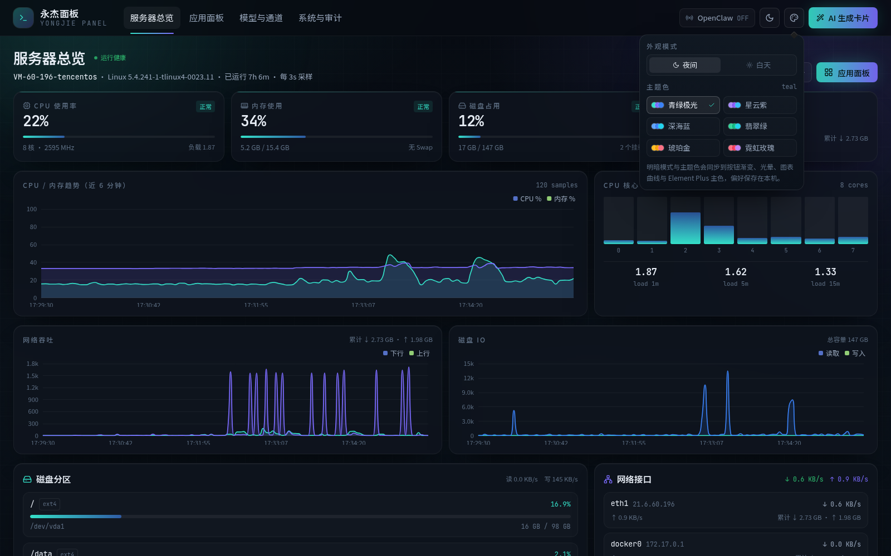

| 模式 | 令牌表现 | 适用场景 |
| --- | --- | --- |
| `dark`（夜间，默认） | 近黑蓝底 + 白色半透明描边，强调色取亮色系 | 值班室、弱光环境 |
| `light`（白天） | 白/浅蓝底 + 墨蓝半透明描边，强调色自动加深保证对比 | 白天办公、投屏演示 |

6 套强调色（每套都有明暗两组色值，白天模式自动使用更深的一档）：

| id | 名称 | 夜间主色 | 白天主色 |
| --- | --- | --- | --- |
| `teal` | 青绿极光 | `#35E0C8` | `#0B7F73` |
| `violet` | 星云紫 | `#A78BFA` | `#6D4AE0` |
| `blue` | 深海蓝 | `#60A5FA` | `#1D4ED8` |
| `emerald` | 翡翠绿 | `#34D399` | `#047857` |
| `amber` | 琥珀金 | `#FBBF24` | `#B45309` |
| `rose` | 霓虹玫瑰 | `#FB7185` | `#BE123C` |

实现要点：

- **双轴主题**：`<html data-mode="dark|light" data-accent="teal|...">`，两组属性分别控制明暗与强调色，互不干扰。
- **表面令牌**：`--ink-950/900/800/700/600`（背景）、`--mist-100/300/500`（文字）、`--tint`（所有 `white/xx` 半透明描边与遮罩基色）
  在浅色模式下整体反色。Tailwind 中 `white` 被重映射为 `rgb(var(--tint) / <alpha-value>)`，
  因此 74 处 `bg-white/[0.03]`、`border-white/[0.06]` 之类的类名无需修改即可适配。
- **强调色对比度**：白天模式的强调色整体加深（如青绿 `#35E0C8 → #0B7F73`），保证白底文字 ≥ 4.5:1；
  强调色渐变上的文字由 `--on-accent` 控制（夜间深字、白天白字）。
- **Element Plus**：夜间挂 `html.dark` 使用官方 dark css-vars，白天移除该类回到亮色变量；再叠加我们自己的 `--el-bg-color / border / text`
  覆盖与 primary 的 light-3/5/7/8/9 派生，抽屉、弹窗、表格、下拉、开关全部一致。
- **图表**：ECharts 的曲线、坐标轴、网格线、tooltip 都按 `isLight` 切换色板，切换后立即重绘。
- **卡片强调色**（青绿 / 星紫 / 电蓝 / 琥珀 / 玫瑰）使用独立的 `hue-*` 静态色板与 `text-icon-ink` 固定深色图标，
  不随全局明暗与主题色翻转，保证多卡片可区分。
- **状态色**（成功 / 告警 / 失败）保持语义固定，白天模式使用加深版本以维持对比度。
- **防闪烁**：`index.html` 内联脚本在首屏渲染前读取偏好并写入 `data-mode` / `data-accent` / `.dark`，避免白屏闪一下再变色。

新增一套主题只需两步：

1. 在 `src/stores/theme.ts` 的 `ACCENT_THEMES` 增加一条（`dark` 与 `light` 各三段 hex）。
2. 在 `src/style.css` 增加 `:root[data-accent='你的id']` 与 `:root[data-mode='light'][data-accent='你的id']` 两个变量块。

### 字号基准

全站字号以 1.2 倍为基准：`body` 15.6px（原 13px）、卡片标题 16.8px、次要信息 12–13.8px、统计数字 21.6–36px。
Element Plus 的 `--el-font-size-base/small/large/extra-large` 同步设为 16.8 / 14.4 / 19.2 / 21.6px，
ECharts 的坐标轴（11px）、图例（12px）与 tooltip（13px）一并放大。

继续调整字号时：

- 组件内的字号集中在 `text-[Npx]` 任意值类，统一搜索替换即可保持层级比例；
- 全局基准与 Element Plus 字号在 `src/style.css` 的 `:root` 中维护；
- 中文文本不要使用 `font-mono`（JetBrains Mono 缺少 CJK 字形，会显示成方块），技术标识符才使用等宽字体。

## 配置项

| 变量 | 默认值 | 说明 |
| --- | --- | --- |
| `DATABASE_URL` | `sqlite:///./data/board.db` | 数据库连接串 |
| `ADMIN_TOKEN` | 空 | 设置后所有非 GET 请求需 `Authorization: Bearer <token>` |
| `COLLECT_INTERVAL` | 5 | 服务卡片采集周期（秒） |
| `HOST_INTERVAL` | 3 | 主机指标采样周期（秒） |
| `HOST_HISTORY_POINTS` | 120 | 主机趋势环形缓冲点数（约 6 分钟） |
| `DOCKER_ENABLED` / `SYSTEMD_ENABLED` / `PORT_ENABLED` | true | 按需关闭采集器 |
| `DSH_BASE_URL` | http://127.0.0.1:3082 | dsh 原生工作区地址 |
| `DSH_TOKEN` | 空 | dsh web 启动 token（每次重启会变化） |
| `DSH_CARDS_STORE` | ~/.dsh/storages/yongjie-cards.json | 卡片 → 工作区映射文件 |

## 主要接口

| 方法 | 路径 | 说明 |
| --- | --- | --- |
| GET | `/api/cards` | 卡片列表（配置 + 最新快照 + 分组统计） |
| POST | `/api/cards` | 创建卡片 |
| PATCH/DELETE | `/api/cards/{id}` | 更新 / 删除卡片 |
| POST | `/api/cards/reorder` | 拖拽排序持久化 |
| POST | `/api/cards/{id}/actions` | 快捷启停 / 重启（写审计） |
| GET | `/api/cards/{id}/metrics` | 指标环形缓冲（约 15 分钟） |
| GET | `/api/cards/{id}/logs` | 容器 / journal 尾部日志 |
| GET | `/api/cards/{id}/dsh` | 卡片对应的 dsh 工作区地址（含 workspaceId 与启动 token） |
| GET | `/api/dsh` | dsh 完整界面入口（顶部页签使用） |
| GET | `/api/host/overview` | 主机快照 + 近 6 分钟趋势（CPU/内存/网络/磁盘/进程） |
| POST | `/api/host/sample` | 立即采样一次（首页刷新按钮） |
| GET/POST | `/api/system/status`、`/api/system/collect` | 调度状态、手动采集 |
| GET | `/api/audit` | 审计日志 |

## 扩展指南

**新增一种被管理的服务类型**

1. `backend/app/services/card_types.py` 注册一份 `CardTypeSpec`（表单字段、图标、指标、工具集）。
2. `backend/app/collectors/` 实现 `BaseCollector`（`available()` + `collect()`），在 `registry.py` 注册。
3. 前端无需改动：卡片表单与详情由 `/api/card-types` 动态渲染。

**模型配置**

卡片对话走 dsh 原生工作区，模型在 dsh「设置 → 模型」中配置（支持 DeepSeek / 自定义 OpenAI 兼容端点），
面板不再保存模型 Key；`DSH_BASE_URL`、`DSH_TOKEN`、`DSH_CARDS_STORE` 用于面板定位 dsh 与卡片映射。

## 安全基线

- 面板不保存模型 API Key：模型、会话、文件与终端都由 dsh 管理。
- 卡片快捷操作（重启 / 停止 / 启动）通过后端工具执行，并写入审计日志。
- `DSH_TOKEN` 等同 dsh 本机 owner 权限，请只在内网使用，并通过反向代理限制访问。
- 默认仅监听 `127.0.0.1`；可选 `ADMIN_TOKEN` Bearer 保护；CORS 白名单化。

## 测试与验收

```bash
make test     # 16 passed 个测试：主机指标、卡片 CRUD、快捷操作、系统状态、采集器
make lint     # ruff
make build    # vue-tsc 类型检查 + vite 构建
```

已在本机完成端到端验证：首页主机指标（CPU/内存/磁盘/网络/进程）实时刷新、看板渲染 4 类卡片、卡片详情页指标曲线与日志、
点击卡片进入对应 dsh 工作区、顶部 dsh 页签、系统审计页，以及白天/夜间 × 6 套主题色切换与刷新后偏好保持（截图见 `docs/screenshots/`）。

## 常见问题

| 现象 | 处理 |
| --- | --- |
| 卡片显示「不可用 · 无法连接 Docker」 | 确认 `/var/run/docker.sock` 已挂载、当前用户有权限；或 `DOCKER_ENABLED=false` |
| systemd 卡片「当前环境未运行 systemd」 | 容器内通常没有 PID 1 的 systemd，请用宿主机运行后端 |
| 端口采集缺少进程信息 | 需要 root 或 CAP_NET_ADMIN 才能读取其他用户进程的连接 |
| 修改卡片后状态未刷新 | 采集周期默认 5s；可在系统页点「立即采集」 |
| 首页主机指标为 0 或不可用 | 容器内 psutil 只能看到 cgroup/宿主可见指标；确认容器未被限制读取 /proc |
| 卡片对话空白 / 无法进入 | 检查 dsh 是否运行、`DSH_BASE_URL` / `DSH_TOKEN` 是否与 dsh 启动日志一致 |
| dsh 重启后卡片打不开 | dsh token 每次启动变化，更新 `.env` 的 `DSH_TOKEN` 并重启后端 |
| 系统 Python 版本过低 | `make install PYTHON=python3.12`，或先安装 ≥3.11 的解释器 |
