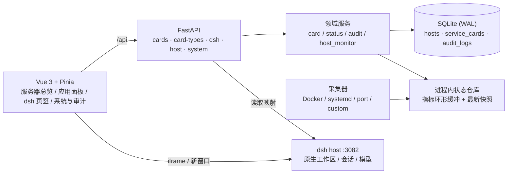
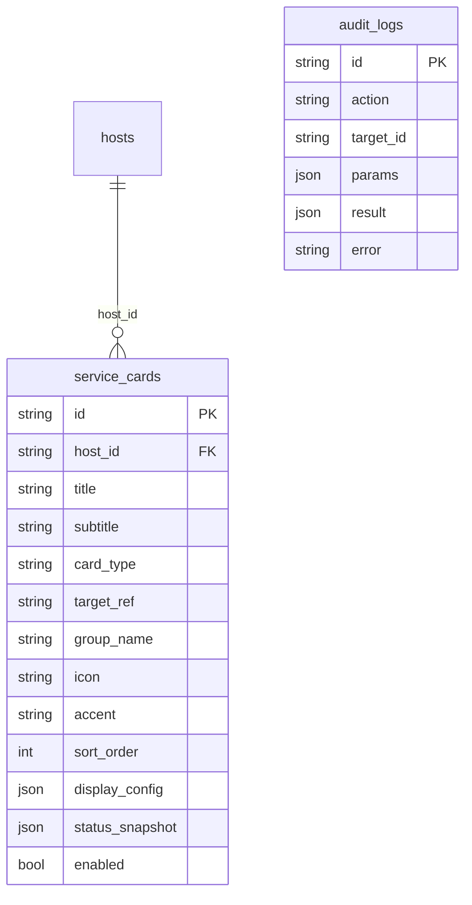

# 架构设计 · 永杰面板

> 目标：单机服务器上的容器、systemd 服务、端口与自定义依赖以「一张卡片」为原子粒度被观察和操作；
> 卡片对话、文件与终端统一交给 dsh（DeepSeek Harness）原生工作区，面板不再内置模型与 Agent。

## 1. 设计目标与约束

- **单机优先**：采集、状态与审计都带 `host` 维度，为多主机预留，但 MVP 只运行一个本地 host。
- **面板与 AI 解耦**：面板不保存模型 Key、不调用大模型；只负责监控、卡片管理与 dsh 跳转。
- **失败可降级**：单个采集器或服务读取失败只影响对应卡片，接口不返回 500。
- **数据可迁移**：卡片 ID 与 dsh 工作区 ID 一对一映射，存储在 `~/.dsh/storages/yongjie-cards.json`。

## 2. 分层架构

前端只与自家 `/api` 和 dsh 通信；所有采集、审计、卡片 CRUD 在后端完成。

## 3. 关键设计决策

### 3.1 配置与状态彻底分离

数据库只存配置与审计（`hosts` / `service_cards` / `audit_logs`）；实时指标、采集诊断与历史曲线放在进程内的
`StatusStore`，由 5s 采集循环写入，页面轮询读取。这样避免高频写库，也保证服务重启后配置不丢。

> 旧版本遗留的 `agents` / `providers` / `chat_*` 表可能仍存在于旧数据库，但已没有对应 ORM 模型与接口，
> 不再参与运行；新部署不会创建它们。

### 3.2 卡片类型注册表

`services/card_types.py` 的 `CardTypeSpec` 驱动前端表单字段、目标校验正则、默认图标/主题与详情展示项。
新增类型只需注册 spec + 采集器，前端不需要硬编码。

### 3.3 dsh 原生工作区

每张卡片对应 `/data/workspaces/<card-id>`：

1. `scripts/migrate_cards_to_workspaces.py` 创建目录、写入 dsh 工作区注册表，并生成 `yongjie-cards.json`；
2. 面板 `GET /api/cards/{id}/dsh` 读取映射，返回带 `workspace` 参数和 dsh token 的地址；
3. 前端 `/cards/:id/workspace` 或 `/dsh` 用 iframe 加载 dsh 原生 UI；
4. dsh 通过 URL `?workspace=<id>` 自动选中工作区，登录重定向保留该参数。

**模型与工具全部在 dsh 内配置**：面板没有供应商、API Key、Agent 与对话代码。

### 3.4 快捷操作与日志

- 卡片启停/重启走 `tools/container_tools.py` / `systemd_tools.py`，执行结果写入审计。
- 日志读取由 `card_service.read_logs()` 直接调用 Docker SDK 或 `journalctl -u <unit>`，不再经过 Agent 工具层。
- 采集失败只把卡片标为「不可用」，不影响接口与其他卡片。

## 4. 数据模型

- `hosts` 目前只有一条 `kind=local` 记录；多主机时新增 `kind=agent` 行。
- `service_cards.status_snapshot` 仅保存最近一次快照，历史曲线在 `StatusStore`。
- 卡片与 dsh 的映射不写数据库，放在 `~/.dsh/storages/yongjie-cards.json`，便于 dsh 独立管理。

## 5. 运行时流程

### 5.1 采集循环

`collectors/scheduler.py` 每 `COLLECT_INTERVAL` 秒并发执行四类采集器，结果写入 `StatusStore`；
`GET /api/cards` 返回配置 + 最新快照，避免 N+1。前端 5s 轮询，页面隐藏时暂停。

### 5.2 主机指标

`services/host_monitor.py` 独立于卡片采集，纯 psutil 采样 CPU/内存/磁盘/网络/进程，
`HOST_INTERVAL=3s`、`HOST_HISTORY_POINTS=120`；容器内只能看到 cgroup/宿主可见指标。

### 5.3 前端状态与页面

- `stores/board.ts` 持有 cards / groups / system / meta，5s 轮询卡片、15s 轮询系统。
- `/` 服务器总览、`/board` 应用面板、`/dsh` 完整 dsh、`/system` 系统与审计。
- 点击卡片跳转 `/cards/:id/workspace`；`/cards/:id` 为卡片概览（指标、日志、快捷操作）。

### 5.4 外观系统

白天/夜间 × 6 套主题色，偏好写入 `localStorage.yongjie.mode` / `yongjie.accent`；
Element Plus 与 ECharts 共用同一强调色变量。

## 6. 扩展点

| 需求 | 位置 | 做法 |
| --- | --- | --- |
| 新卡片类型 | `services/card_types.py` + `collectors/` | 注册 `CardTypeSpec` 与 `BaseCollector`，前端自动渲染 |
| 新采集指标 | `collectors/*` + `StatusStore` | 写入 snapshot 字段，前端按需展示 |
| 新快捷操作 | `tools/*.py` | 注册 handler，`card_service` 调度并写审计 |
| 新页面 | `frontend/src/views` + `router.ts` | 添加路由与导航项 |
| 多主机 | `hosts` 表 + 采集层 | 增加 `kind=agent` 行与上报接口 |

## 7. 性能与可靠性

- 采集与主机监控在单进程内，后端必须 **单 worker**；多 worker 会重复采集、重复写审计。
- SQLite 开 WAL，写入以配置与审计为主，压力很小。
- 采集器超时 8s、日志读取 10s；单卡失败不阻塞其他卡片。
- dsh 使用独立 host，面板故障不影响已有工作区；dsh 重启后需同步新的 token。

## 8. 安全基线

- 面板不保存模型 Key；dsh token 等同本机 owner 权限，只应绑定回环或置于反向代理之后。
- 默认监听 `127.0.0.1`；可选 `ADMIN_TOKEN` Bearer 保护写接口；CORS 白名单化。
- 破坏性快捷操作写入审计（操作、目标、结果、时间）。
- dsh 与面板共享单机权限，部署时请限制登录用户与网络入口。

## 9. 演进路线

1. **dsh 深度整合**：把卡片网格作为 dsh 客户端插件，减少 iframe 与双导航。
2. **多主机**：宿主机 agent 上报快照，面板只负责聚合与展示。
3. **审计增强**：记录 dsh 会话与工作区操作，形成统一操作流水。
