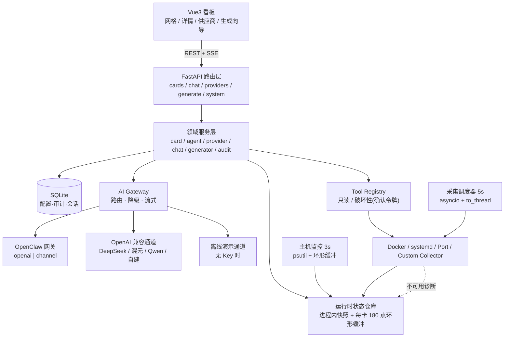
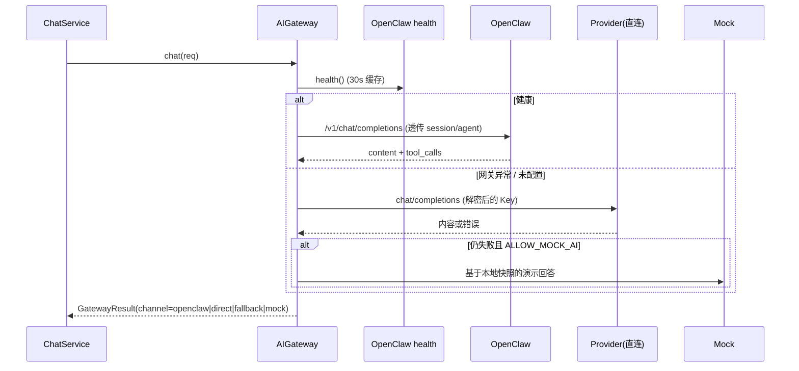
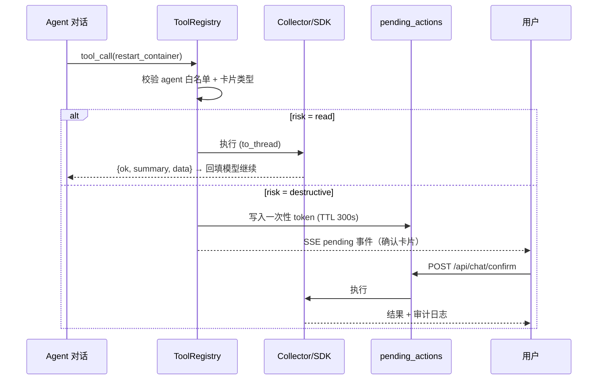
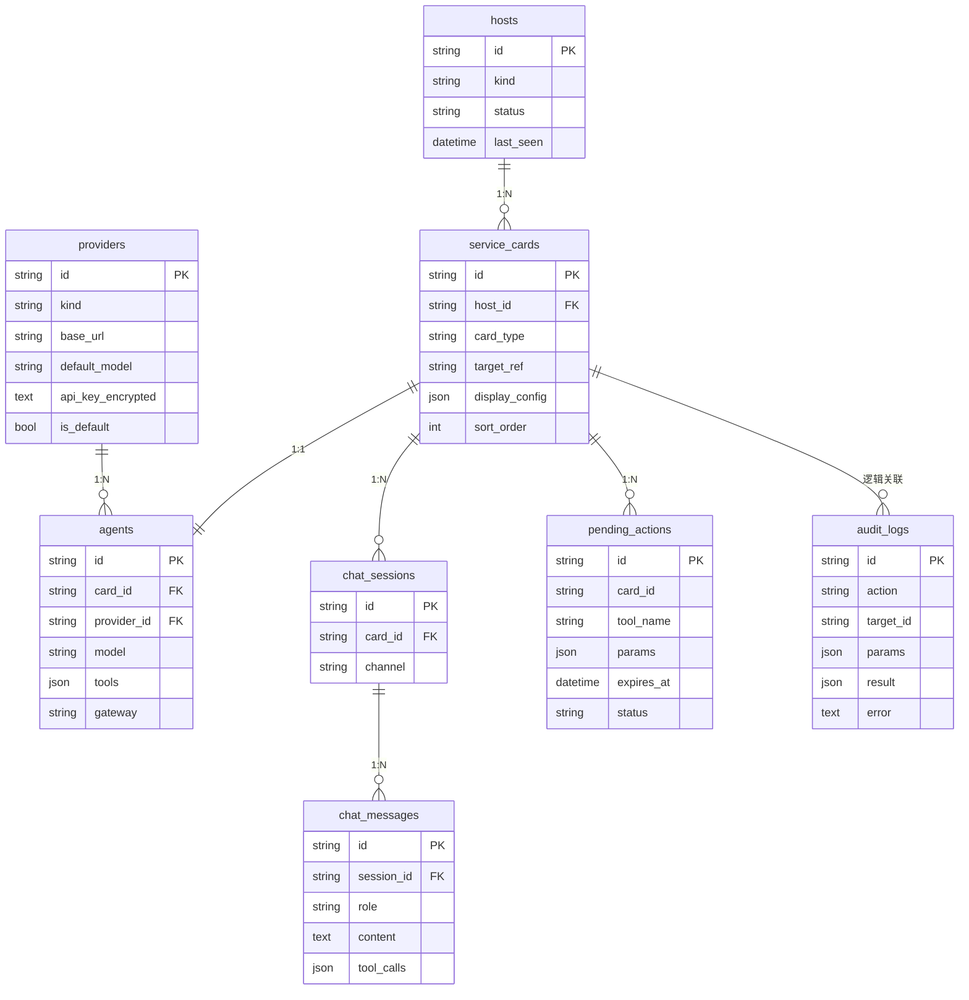

# 架构设计 · 永杰面板

> 目标：单机服务器上的一切服务都能以「一张卡片 + 一个 agent」的原子粒度被观察、被对话、被操作，
> 并且这套结构在新增服务类型、新增模型厂商、后续扩展到多主机时都不需要重写核心。

## 1. 设计目标与约束

| 目标 | 落地方式 |
| --- | --- |
| 架构清晰 | 路由层只做参数校验与序列化，业务全在 `services/`；采集、AI、工具各自独立包 |
| 可扩展 | 卡片类型注册表（前端动态渲染）、采集器契约、工具注册表、供应商适配器四处扩展点 |
| 易维护 | Pydantic v2 契约 + TypeScript 类型、统一错误模型、Alembic 迁移、结构化日志、测试隔离 |
| 可降级 | 采集器 / AI 网关 / 模型供应商三层都定义「不可用」语义，绝不把异常抛成 500 |
| 安全 | Key 加密、命令白名单、破坏性操作确认令牌、审计留痕、默认仅本地监听 |

**已确认的产品范围**：OpenClaw 作为 AI 能力网关（不是被监控对象）；管理对象为 Docker 容器 + systemd unit + 端口服务；
MVP 单机部署，但所有采集与数据模型都带 `host` 维度，为多主机 agent 预留。

## 2. 分层架构



**依赖方向**：`api → services → (db | collectors | ai | tools)`。反向依赖不存在：采集器不 import 服务层，
AI 层不 import ORM（只吃 `ProviderConfig` dataclass），工具层只通过 `ToolContext` 协议拿到卡片标识。

## 3. 关键设计决策

### 3.1 配置与状态彻底分离

数据库只存「配置类」数据（hosts / cards / agents / providers / chat / pending / audit）；
CPU、内存、端口、运行时长、健康度等**运行时状态**由 5s 调度写入进程内 `StatusStore`，API 直接读内存。

- 收益：采集频率再高也不会造成 SQLite 写放大；指标趋势不落库，DB 体积稳定。
- 代价：进程重启后指标历史丢失（首轮采集 5s 内回填），符合运维看板预期。
- `service_cards.status_snapshot` 字段保留为非权威缓存，重启后亦可立即渲染上次状态。

### 3.2 卡片类型注册表

`services/card_types.py` 的 `CardTypeSpec` 同时驱动三件事：前端表单字段与校验正则、详情页展示项、agent 默认工具集。
`GET /api/card-types` 一次返回全部类型与工具元数据，前端**没有硬编码任何类型分支**。
新增服务类型 = 注册 spec + 实现 collector，无需改动路由、前端页面。

### 3.3 AI Gateway 三通道



- 三家厂商（DeepSeek / 混元 / Qwen）共用 `OpenAICompatClient`，差异只体现在 `PRESETS` 的 base_url 与模型列表。
- `channel` 回传前端并展示，降级不是静默行为。
- 流式解析在客户端内完成 tool_call 增量拼装（按 index 聚合），对上层统一为 `{type: text|done}` 事件。

### 3.4 工具编排与确认令牌



约束：单轮最多 4 次工具迭代（防死循环）；非白名单工具直接拒绝并回填错误信息；
`journalctl` / `systemctl` 一律 argv 列表并做 unit 正则校验，永不拼接 shell 字符串。

### 3.5 AI 生成卡片

`gateway.structured()` 使用 `response_format=json_object`，失败自动追加纠正提示重试一次；
若最终无法解析或处于 mock 通道，回落到**关键词启发式草稿**（识别 容器/端口/systemd、引号中的目标名、端口号）。
无论来源如何，草稿都要经过 `CardDraft` 校验 + `_clamp()`（类型合法、工具裁剪到该类型白名单、配色/图标兜底），
再由前端向导确认后走**同一条** `POST /api/cards` 写入路径，避免第二条写入链路。

## 4. 数据模型



要点：

- `hosts` 目前只有一条 `kind=local` 记录；多主机时新增 `kind=agent` 行，卡片通过 `host_id` 归属。
- `agents.tools` 与 `providers.models` 用 JSON 列存列表，避免关联表膨胀。
- `pending_actions.status`：`pending → executed | failed | expired`，确认接口做幂等与过期检查。
- `audit_logs.error` 与 `result` 二选一，便于系统页统一渲染成功/失败。

## 5. 运行时流程

### 5.1 采集循环

```
每 5s:
  load_targets()（线程池执行一次 SELECT：id, type, target_ref）
  group by card_type
  for each kind:
      collector.available() → False 则全部卡片写 unavailable + reason，continue
      await wait_for(collector.collect(targets), 8s)   # 单目标异常在内部降级
      _decorate(): CPU≥85% 或 内存≥90% 提升为 warning
      store.put(card_id, snapshot)
  store.set_diagnostics(items, duration_ms)
```

前端 `GET /api/cards` 一次性返回「配置 + 最新快照」，避免 N+1；卡片详情页（`/cards/:id`）单独轮询 `/metrics` 获取趋势。

### 5.2 前端状态与轮询

- `stores/board.ts` 统一持有 cards / groups / system / meta，5s 轮询卡片、15s 轮询系统，`document.hidden` 时暂停。
- 卡片详情是独立路由页而非弹层：`/cards/:id`，标签页写入 `?tab=overview|chat|config`，支持刷新与分享；直接访问不存在的 ID 渲染 404 空态。
- SSE 使用 `fetch + ReadableStream`（EventSource 无法携带 POST body），事件类型：`session / tools / route / delta / tool_call / tool_result / pending / done / error`。
- 拖拽排序用 SortableJS（`.drag-handle` 手柄），`onEnd` 读取 DOM 顺序后调用 `/cards/reorder`，失焦即持久化。

### 5.3 外观系统（明暗模式 × 主题色）

外观是**双轴**的：`<html data-mode="dark|light" data-accent="teal|violet|blue|emerald|amber|rose">`，
两个属性分别控制明暗与强调色，可任意组合（12 种外观）。实现分三层：

1. **令牌层**（`style.css`）
   - 表面：`--ink-950/900/800/700/600`（背景层级）、`--mist-100/300/500`（文字层级）、`--tint`（半透明描边/遮罩基色）；
   - 强调：每套主题在夜间与白天各定义一次 `--accent-1/2/3`（RGB 三元组）与 `--accent-*-hex`；
   - 语义：`--on-accent`（强调色上的文字，夜间深/白天白）、`--ok/--warn/--bad`（白天使用加深版本）。
2. **映射层**（`tailwind.config.js`）
   - `ink-*` / `mist-*` / `state-*` 映射到上述变量；
   - 覆盖内置 `white` 为 `rgb(var(--tint) / <alpha-value>)`，使 74 处 `bg-white/[0.03]`、`border-white/[0.06]`
     在浅色下自动变成墨蓝半透明，无需逐文件改写；
   - 卡片强调色改用与主题解耦的静态 `hue-*` 色板 + 固定 `text-icon-ink`，避免被全局主题/明暗覆盖。
3. **运行时**（`stores/theme.ts`）
   - 切换 `data-mode` / `data-accent` 与 `html.dark` 类（Element Plus 官方 dark css-vars 依赖该类）；
   - 由当前模式的强调色派生 Element Plus `--el-color-primary` 与 light-3/5/7/8/9、dark-2；
   - ECharts 读取 `isLight` 与 `colors` 重绘曲线、坐标轴、网格与 tooltip；
   - 偏好写入 `localStorage.yongjie.mode` 与 `localStorage.yongjie.accent`。

**防闪烁**：`index.html` 内联脚本在首屏渲染前把偏好写回 `data-*` 与 `.dark`，`main.ts` 挂载前再次 `init()`，
因此不会出现「先白后暗」或强调色跳变。切换本身只改属性与 CSS 变量，不发起网络请求。

**字号基准**：全站按 1.2× 基准排版（正文 15.6px、卡片标题 16.8px），组件内使用 `text-[Npx]` 任意值保持层级，
Element Plus 的 `--el-font-size-*` 与 ECharts 字号同步；中文字段禁用 `font-mono`，避免等宽字体缺少 CJK 字形。

### 5.4 主机指标（首页总览）

主页看板不复用卡片采集链路，而是独立的 `services/host_monitor.py`：

- **采样源**：只用 psutil 读取本机指标，不依赖 Docker / systemd，因此容器运行时不可用时首页仍有数据。
- **采样节奏**：`HOST_INTERVAL=3s`，历史 `HOST_HISTORY_POINTS=120`（约 6 分钟）存进程内 `deque`，不落库。
- **速率类指标**：网络与磁盘 IO 通过相邻两次 `bytes` 计数差除以时间差得到；首次采样记 0，避免出现负数或虚假峰值。
- **快照结构**：`system / cpu（含 per_core）/ memory（含 swap）/ disk（分区 + io）/ network（网卡 + 速率）/ processes / health / history`。
- **健康判定**：CPU ≥ 90%、内存 ≥ 90%、磁盘 ≥ 90% 进入 warning，两项及以上为 critical；前端 KPI 与徽标按阈值着色。
- **降级**：任何 psutil 异常只返回 `available=false` + 原因，不影响卡片看板与 AI 功能；前端展示重试。
- **开销**：单次采样包含一次进程遍历与分区扫描，约 10~30ms；3s 周期对单机可忽略。

## 6. 扩展点清单

| 扩展点 | 位置 | 步骤 |
| --- | --- | --- |
| 新服务类型 | `services/card_types.py` + `collectors/*` + `collectors/registry.py` | 注册 spec → 实现 `BaseCollector` → 注册；前端自动渲染表单 |
| 新 agent 工具 | `tools/*.py` | `ToolSpec(name, description, params, risk, kinds, handler)`，注册即生效 |
| 新模型厂商 | `ai/providers.py` `PRESETS` | 加一条预设；若协议不同，包一层 client 适配 |
| 新 AI 通道 | `ai/gateway.py` `resolve()` | 保持 `chat/stream` 契约即可插入 |
| 多主机 | `hosts` 表 + 采集层 | agent 上报快照到 `/api/system/ingest`（下一步），`StatusStore` 增加 host 维度 |
| 权限体系 | `core/security.py` | 将单 token 扩展为 RBAC，`require_admin` 换成角色依赖 |

## 7. 性能与可靠性

- 阻塞调用（docker SDK / subprocess / psutil）全部 `asyncio.to_thread`，不阻塞事件循环；
  同一类型内多目标用 `asyncio.gather` 并行。
- `docker stats(stream=False)` 是主要开销（每容器 1~1.5s）。>30 张容器卡时的优化路径：
  改为按需采样 + `docker events` 驱动状态变更，已在代码注释与本节标注。
- 单次采集整体 8s 超时，超时按目标降级为 `unavailable`，不拖垮循环。
- 日志只读尾部（≤500 行、按需触发），不进轮询；指标历史为每卡 180 点 deque。
- 统一错误分类：`unavailable / denied / timeout / upstream_error / not_configured / validation / not_found`，
  前端按 code 展示不同提示。
- 结构化 JSON 日志，自动脱敏 `api_key / authorization / token / sk-*`。

## 8. 安全基线

1. **密钥**：Fernet 加密，密钥由 `SECRET_KEY` SHA-256 派生；序列化层只输出掩码，无任何回显接口。
2. **命令**：`systemctl` / `journalctl` 使用 argv 白名单 + unit 正则；容器操作走 docker SDK。
3. **破坏性操作**：白名单校验 → 一次性令牌（TTL）→ 执行 → 审计，四步缺一不可。
4. **暴露面**：默认 `127.0.0.1`；`ADMIN_TOKEN` 开启后所有非 GET 请求需 Bearer；CORS 白名单。
5. **容器运行**：docker.sock 只读挂载，非特权；Compose 中前端 nginx 关闭 SSE 缓冲以满足流式。

## 9. 演进路线

1. **多主机**：新增 ingest 接口 + host 维度隔离，前端按 host 分组/筛选。
2. **采集优化**：`docker events` + 自适应采样；指标落 Prometheus/VM 而非内存。
3. **权限与协作**：RBAC、操作人身份（当前审计 actor 固定 `operator`）、会话共享。
4. **Agent 能力**：把看板工具反向暴露为 MCP server，供 OpenClaw skills 调用；支持多 agent 协作与计划任务。
5. **部署形态**：从「后端在宿主机」演进为「宿主机 agent + 中心看板」，解锁 systemd 与多机统一视图。
